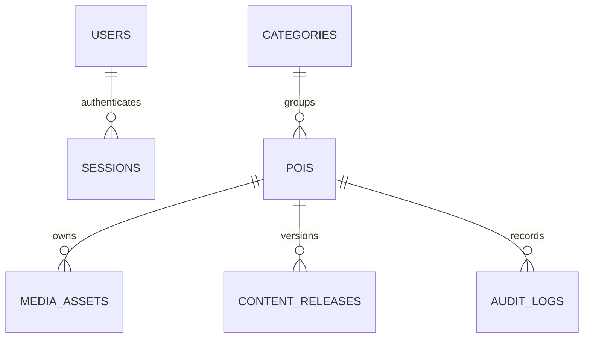

# Kiến trúc và quyết định

## Giai đoạn 0

Thư mục ban đầu chỉ có `.git` và `.gitattributes`, commit `95fe889`. Không có AGENTS.md, README, cấu hình hay mã ứng dụng cần giữ lại. Khởi tạo theo công nghệ được yêu cầu. Trọng tâm giao diện: thao tác ngắn, dùng từ quen thuộc, giảm thuật ngữ, hướng dẫn theo bốn bước, thông báo lỗi tại chỗ.

Máy ban đầu không có `node`/`npm` trong PATH; Python alias không chạy được. Đã tải Node 22.22.0 portable vào `.tools/`, Python 3.12 bằng uv, cài dependencies và giữ `package-lock.json`, `services/backend/uv.lock`, `.python-version`. Không tự nâng các dependency sang major mới; các phiên bản cụ thể được khóa trong hai lockfile.

## Cấu trúc

```text
apps/admin/           React + TS + Vite, giao diện quản trị
apps/web/             React + TS + Vite, nội dung công khai và audio
packages/contracts/   Kiểu dữ liệu dùng chung
packages/api-client/  HTTP client, cookie, lỗi thống nhất
services/backend/     FastAPI modular monolith
  app/auth.py         Phiên đăng nhập, mật khẩu, kiểm tra vai trò
  app/content.py      Quy tắc nội dung, phiên bản và xuất bản
  app/main.py         REST routes, upload, media, health
  migrations/         Alembic, schema được quản lý bằng migration
tests/e2e/            Luồng trình duyệt desktop/mobile mô phỏng
```

## Dữ liệu Giai đoạn 1



`pois.translations` lưu JSON hai ngôn ngữ trong phạm vi Giai đoạn 1, chưa chuẩn hóa thành bảng `poi_translations`. `media_assets.text_hash` liên kết audio với đúng văn bản; locale và poi_id giữ liên kết ngôn ngữ/địa điểm. Revision của POI dùng optimistic concurrency ở cả API và SQLAlchemy, trả 409 khi một phiên cố ghi đè phiên khác.

`content_releases.snapshot` là bản chụp văn bản/metadata/media bất biến. `is_current` chỉ là con trỏ phát hành có thể thay đổi; snapshot không bị sửa. Khi biên tập bản đang phát hành, `pois` chuyển về draft nhưng bản phát hành vẫn tồn tại. Khi xuất bản lại, con trỏ được chuyển trong cùng transaction. Lưu trữ gỡ con trỏ; snapshot và media được giữ lại. Khôi phục sao chép vào draft mới với revision tăng.

Role hiện là một cột có constraint trong users; chưa triển khai đa vai trò `roles/user_roles`. Khóa ngoại, unique email, unique danh mục, unique `(poi_id, revision)`, constraint trạng thái/tọa độ và index đã có. PostgreSQL có cột geography được sinh từ longitude/latitude và GIST index; SQLite local dùng hai số thực và không cung cấp nearby query.

## API

Tiền tố `/api/v1`, schema thực tế tại `/docs`.

| Nhóm | Endpoint chính |
| --- | --- |
| Phiên | `POST /auth/login`, `GET /auth/me`, `POST /auth/logout` |
| Sức khỏe | `GET /health/live`, `GET /health/ready` |
| Admin | `GET/POST /admin/pois`, `GET/PUT /admin/pois/{id}` |
| Quy trình | `POST /admin/pois/{id}/actions` với action + revision |
| Upload | `POST /admin/pois/{id}/upload?kind=audio&locale=vi&revision=...` |
| Lịch sử | `GET /admin/pois/{id}/history` |
| Danh mục | `GET/POST /admin/categories`, `DELETE /admin/categories/{id}` (chỉ danh mục trống, admin) |
| Tổng quan | `GET /admin/summary` |
| Du khách | `GET /pois`, `GET /pois/{id}?locale=vi` |
| Tệp | `GET /media/{id}`; nháp yêu cầu phiên, đã phát hành cho phép guest |

Tham số list admin: `q`, `status`, `category`, `sort=updated|name`, `page`, `page_size` (1–100). Tìm không dấu bằng Unicode normalization; hiện tải các POI phù hợp trước khi lọc tên trong Python, phù hợp phạm vi 10–20 mẫu nhưng cần chuyển sang truy vấn index/search khi mở rộng. Màn hình bản dịch lấy tối đa 100 POI, chưa có phân trang riêng.

Lỗi dạng `{ "detail": "thông báo" }`, header `X-Request-ID`, không echo input nhạy cảm trong lỗi validation. Các thao tác ghi yêu cầu header `X-Requested-With: Quan1Admin`; browser HTTP client dùng same-origin proxy. Không mở CORS tùy ý. Cookie HttpOnly/SameSite Strict, 8 giờ; token ngẫu nhiên chỉ lưu hash phía server. Logout thu hồi phiên. Rate limit login trong bộ nhớ một process; cần kho chia sẻ khi triển khai nhiều worker.

Ảnh: JPG/PNG/WebP, tối đa 10 MB/20 triệu pixel, Pillow kiểm tra. Audio: MP3/WAV/OGG/M4A, tối đa 50 MB/2 giờ, Mutagen kiểm tra metadata/codec/container và MIME. Không kiểm chứng ngữ nghĩa bản ghi âm so với văn bản; người duyệt phải nghe thử. `FileResponse` hỗ trợ Range, Content-Type và nosniff; không mount thư mục upload làm static công khai.

Frontend không dùng `dangerouslySetInnerHTML`; bài thuyết minh là plain text được React escape. Không gọi dịch/TTS trong đường phát audio. Không có credentials dịch/TTS, và không có API tự động giả lập thành công.

## Giai đoạn sau

Tour/tour_stops, Expo, AudioController chung, GPS engine, offline manifest/checksum/staging/atomic activation, idempotent playback events, nền iOS/Android và offline map đều **chưa triển khai**. Cần kiểm thử thiết bị thật sau khi có mobile; viewport Pixel 7 chỉ kiểm tra bố cục web. Chuẩn hóa translations/roles trước khi mở rộng. Chuẩn bị adapter S3 và dịch/TTS/worker tại giai đoạn tương ứng; hiện chưa có interface provider hoàn chỉnh.

## Tham khảo

- [Vite: Getting Started](https://vite.dev/guide/) — yêu cầu Node và cơ chế phát triển/build.
- [FastAPI: Request Files](https://fastapi.tiangolo.com/tutorial/request-files/) — multipart và UploadFile.
- [SQLAlchemy ORM Quick Start](https://docs.sqlalchemy.org/en/20/orm/quickstart.html) — mapped models, sessions, transactions.
- [Appmuseus](https://github.com/humbertblanco/appmuseus) — tham khảo phạm vi audioguide/CMS/đa ngôn ngữ; không sao chép mã hay tài sản. Repo công bố MIT, nhưng không đưa mã từ repo vào dự án này. Các repo gợi ý khác chưa được đánh giá chi tiết.
