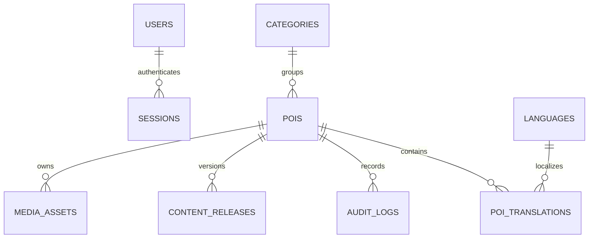

# Kiến trúc và quyết định

## Giai đoạn 0

Thư mục ban đầu chỉ có `.git` và `.gitattributes`, commit `95fe889`. Không có AGENTS.md, README, cấu hình hay mã ứng dụng cần giữ lại. Khởi tạo theo công nghệ được yêu cầu. Trọng tâm giao diện: thao tác ngắn, dùng từ quen thuộc, giảm thuật ngữ, hướng dẫn theo bốn bước, thông báo lỗi tại chỗ.

Máy ban đầu không có `node`/`npm` trong PATH; Python alias không chạy được. Đã tải Node 22.22.0 portable vào `.tools/`, Python 3.12 bằng uv, cài dependencies và giữ `package-lock.json`, `services/backend/uv.lock`, `.python-version`. Không tự nâng các dependency sang major mới; các phiên bản cụ thể được khóa trong hai lockfile.

## Cấu trúc

```text
apps/admin/           React + TS + Vite, giao diện quản trị
apps/web/             React + TS + Vite, nội dung công khai và TTS từ văn bản
packages/contracts/   Kiểu dữ liệu dùng chung
packages/api-client/  HTTP client, cookie, lỗi thống nhất
services/backend/     FastAPI modular monolith
  app/auth.py         Phiên đăng nhập, mật khẩu, kiểm tra vai trò
  app/content.py      Quy tắc nội dung, phiên bản và xuất bản
  app/main.py         REST routes, upload, media, health
  migrations/         Alembic, schema được quản lý bằng migration
tests/e2e/            Luồng trình duyệt desktop/mobile mô phỏng
```

## Dữ liệu Giai đoạn 1



Migration `0003` thay `pois.translations` JSON bằng `poi_translations`, khóa chính `(poi_id, locale)` và khóa ngoại tới `pois`/`languages`. Tiêu đề và bài thuyết minh là văn bản; không tạo/lưu audio mới. `languages` lưu danh sách mở rộng, tên bản địa, mã giọng đọc, bật/tắt, bắt buộc, thứ tự và hướng chữ. Có sẵn 15 lựa chọn, Việt/Anh bắt buộc mặc định. Revision của POI dùng optimistic concurrency ở cả API và SQLAlchemy, trả 409 khi một phiên cố ghi đè phiên khác. [Chi tiết DB](DATABASE.md).

`content_releases.snapshot` là bản chụp văn bản/metadata/media bất biến. `is_current` chỉ là con trỏ phát hành có thể thay đổi; snapshot không bị sửa. Khi biên tập bản đang phát hành, `pois` chuyển về draft nhưng bản phát hành vẫn tồn tại. Khi xuất bản lại, con trỏ được chuyển trong cùng transaction. Lưu trữ gỡ con trỏ; snapshot và media được giữ lại. Khôi phục sao chép vào draft mới với revision tăng.

Role hiện là một cột có constraint trong users; chưa triển khai đa vai trò `roles/user_roles`. Khóa ngoại, unique email, unique danh mục, unique `(poi_id, revision)`, constraint trạng thái/tọa độ và index đã có. PostgreSQL có cột geography được sinh từ longitude/latitude và GIST index; SQLite local dùng hai số thực và không cung cấp nearby query.

## API

Tiền tố `/api/v1`, schema thực tế tại `/docs`.

| Nhóm | Endpoint chính |
| --- | --- |
| Tài khoản du khách/phiên | `POST /auth/register`, `POST /auth/login`, `GET /auth/me`, `POST /auth/logout` |
| Phiên quản trị | `POST /admin/auth/login`, `GET /admin/auth/me` (chỉ editor/reviewer/admin) |
| Sức khỏe | `GET /health/live`, `GET /health/ready` |
| Admin | `GET/POST /admin/pois`, `GET/PUT /admin/pois/{id}` |
| Quy trình | `POST /admin/pois/{id}/actions` với action + revision |
| Upload ảnh | `POST /admin/pois/{id}/upload?kind=image&revision=...` |
| Ngôn ngữ công khai/quản trị | `GET /languages`, `GET /admin/languages` |
| Thêm/sửa ngôn ngữ (admin) | `POST /admin/languages`, `PUT /admin/languages/{code}` |
| Lịch sử | `GET /admin/pois/{id}/history` |
| Danh mục | `GET/POST /admin/categories`, `DELETE /admin/categories/{id}` (chỉ danh mục trống, admin) |
| Tổng quan | `GET /admin/summary` |
| Du khách | `GET /pois`, `GET /pois/{id}?locale=vi` |
| Tệp | `GET /media/{id}`; nháp yêu cầu phiên editor/reviewer/admin, đã phát hành cho phép guest |

Tham số list admin: `q`, `status`, `category`, `sort=updated|name`, `page`, `page_size` (1–100). Tìm không dấu bằng Unicode normalization; hiện tải các POI phù hợp trước khi lọc tên trong Python, phù hợp phạm vi 10–20 mẫu nhưng cần chuyển sang truy vấn index/search khi mở rộng. Màn hình bản dịch lấy tối đa 100 POI, chưa có phân trang riêng.

Lỗi dạng `{ "detail": "thông báo" }`, header `X-Request-ID`, không echo input nhạy cảm trong lỗi validation. Các thao tác ghi yêu cầu header `X-Requested-With: Quan1Admin`; browser HTTP client dùng same-origin proxy. Không mở CORS tùy ý. Cookie HttpOnly/SameSite Strict, 8 giờ; token ngẫu nhiên chỉ lưu hash phía server. Logout thu hồi phiên. Rate limit login trong bộ nhớ một process; cần kho chia sẻ khi triển khai nhiều worker.

Đăng ký nhận `name`, `email`, `password`, từ chối trường khác và luôn gán `visitor`. Email được trim/chuyển chữ thường và kiểm tra định dạng; mật khẩu 8–200 ký tự được băm Argon2. Email trùng trả 409, dữ liệu sai trả 422, quá 10 lượt đăng ký/IP trong 5 phút trả 429. Đăng ký thành công trả 201 và tạo phiên ngay; đăng nhập thay phiên hiện tại. Mọi endpoint `/admin` đều kiểm tra vai trò; phiên du khách không mở quyền xem bản nháp hoặc media riêng. Migration `0002` mở rộng constraint vai trò, giữ lại tài khoản/phiên cũ; SQLite tạm ngừng FK trên kết nối migration để dựng lại bảng users rồi kiểm tra khóa ngoại.

Ảnh: JPG/PNG/WebP, tối đa 10 MB/20 triệu pixel, Pillow kiểm tra nội dung và MIME. Endpoint từ chối upload audio. Media cũ giữ nguyên để bảo toàn dữ liệu/URL đã phát hành, nhưng API nội dung mới chỉ trả văn bản và `tts_ready`. `FileResponse` hỗ trợ Range, Content-Type và nosniff; không mount thư mục upload làm static công khai.

Frontend không dùng `dangerouslySetInnerHTML`; bài thuyết minh là plain text được React escape. `SpeechPlayer` dùng chung cho admin và du khách gọi Web Speech API sau thao tác người dùng, chọn giọng cùng ngôn ngữ, chia văn bản dài thành đoạn tối đa 180 ký tự, bỏ sự kiện cũ sau khi dừng, dừng khi đổi địa điểm/ngôn ngữ hoặc đóng preview. Chỉ một player được đọc tại một thời điểm. Không có khóa API, worker hoặc tệp audio cho TTS. Giao diện thông báo trình duyệt/giọng không khả dụng và lỗi phát. Các giọng có thể do hệ điều hành hoặc dịch vụ của trình duyệt cung cấp; không cam kết offline. Chưa tích hợp dịch tự động.

## Giai đoạn sau

Tour/tour_stops, Expo, GPS engine, offline manifest/checksum/staging/atomic activation, idempotent playback events, nền iOS/Android và offline map đều **chưa triển khai**. Cần kiểm thử giọng đọc và hành vi nền trên thiết bị thật; viewport Pixel 7 chỉ kiểm tra web. Có thể bổ sung nhà cung cấp TTS máy chủ/dịch tự động sau này; hiện chưa tích hợp dịch vụ đó.

## Tham khảo

- [Vite: Getting Started](https://vite.dev/guide/) — yêu cầu Node và cơ chế phát triển/build.
- [FastAPI: Request Files](https://fastapi.tiangolo.com/tutorial/request-files/) — multipart và UploadFile.
- [SQLAlchemy ORM Quick Start](https://docs.sqlalchemy.org/en/20/orm/quickstart.html) — mapped models, sessions, transactions.
- [Appmuseus](https://github.com/humbertblanco/appmuseus) — tham khảo phạm vi audioguide/CMS/đa ngôn ngữ; không sao chép mã hay tài sản. Repo công bố MIT, nhưng không đưa mã từ repo vào dự án này. Các repo gợi ý khác chưa được đánh giá chi tiết.
