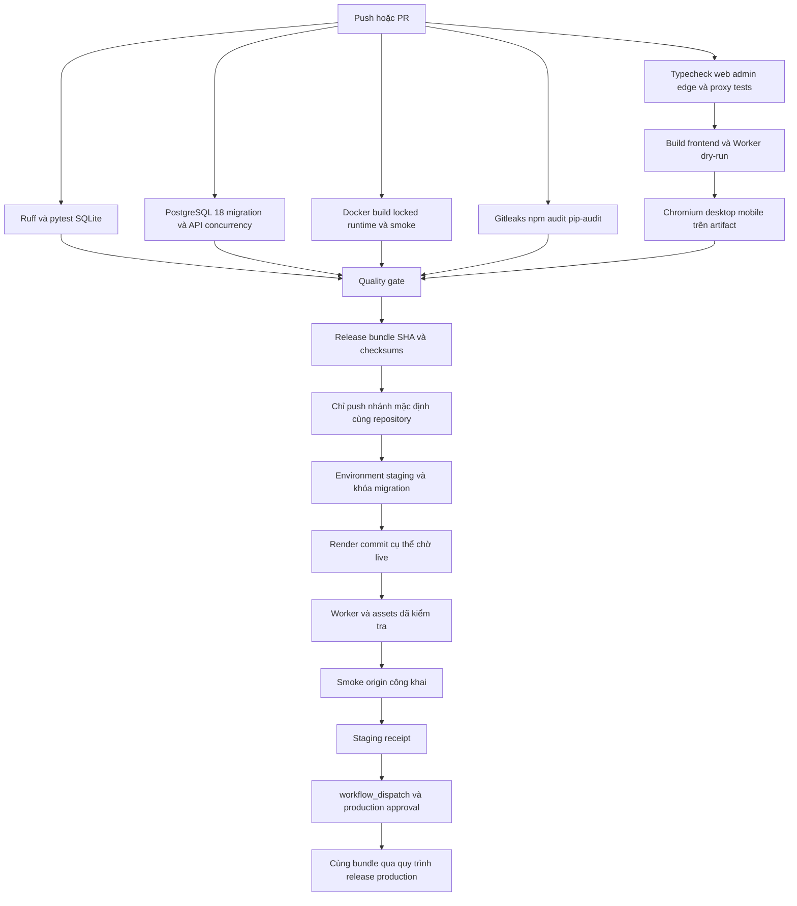

# CI/CD quan1tourism

Phạm vi: web/admin React + TypeScript, packages dùng chung, FastAPI/SQLAlchemy/Alembic,
PostgreSQL, Worker/Pages proxy, Ollama pull worker trên PC. Không có Expo/native pipeline.
Đợt hoàn thiện này chỉ sửa repository và chạy QA cô lập; không deploy hoặc đổi cloud.
Audit ban đầu: [CICD-AUDIT.md](CICD-AUDIT.md). Bằng chứng chạy: [CICD-VERIFICATION.md](CICD-VERIFICATION.md).

## Required checks

Bật branch protection/ruleset cho nhánh mặc định: bắt buộc PR, review và **Quality gate**,
**Release bundle**. Các job thành phần: **Backend**, **Frontend and edge**, **PostgreSQL integration**,
**Built artifact E2E**, **Docker verification**, **Security**. Gate yêu cầu tất cả thành công;
failed/cancelled/skipped đều chặn. Không có `continue-on-error`. Không cho bypass không kiểm soát.
Không dùng `pull_request_target`. CI không nhận deploy secret.

CI chạy Ubuntu, Node 22, Python 3.12, uv 0.13.4; `npm ci`, `uv sync --frozen`.
Lockfile npm được giữ nguyên; uv.lock nâng Pillow lên 13.0.0 để sửa advisory phát hiện khi audit.
Playwright cài Chromium bằng `npx playwright install --with-deps chromium`; không phụ thuộc Edge.
Playwright phục vụ `apps/web/dist` và `/admin/`, không dùng Vite dev server. HTTP ngoài loopback,
tile, ảnh và TTS được mock; backend tests cấm socket HTTP ngoài loopback.

PostgreSQL service dùng major **18** theo bản local đã đọc/chạy. Chưa xác minh major/extension của cloud.
Owner phải chạy `SHOW server_version` ở cloud bằng công cụ quản trị chỉ đọc; nếu khác, thêm major đó
vào matrix trước khi bật CD. CI không dùng `DATABASE_URL` cloud. `--postgres` chỉ chấp nhận
`TEST_POSTGRES_URL` loopback, database `quan1_ci`, mỗi test có schema UUID và cleanup riêng.
Test từ base/0007 lên head, chạy lặp, so dữ liệu accounts/sessions/POI/bản dịch/media/release/audit/
identity/AI job/lease/worker; kiểm tra RLS, schema và projection của revision trước.
Toàn bộ API suite, bao gồm cửa sổ 30 phút và concurrent upsert/increment, chạy thêm trên PostgreSQL.
Nhánh PostGIS vẫn cần kiểm thử riêng nếu cloud có extension; image postgres:18 chuẩn không có PostGIS.

Docker production chạy `uv sync --frozen --no-dev --no-install-project`; không cài pip từ khoảng phiên bản.
CI build Docker rồi smoke với SQLite tạm chỉ trong container, kiểm tra package cài đúng uv.lock và không có pytest.
`CMD` không migrate. Các base image tag chưa được khóa digest; Render Git-backed rebuild đúng commit,
không được hiểu là chạy cùng Docker image digest của CI. Muốn bảo đảm byte-for-byte image cần quy trình registry
được phê duyệt riêng, không đổi runtime/service trong nhiệm vụ này.

## Artifact và nguồn release

`candidate-<sha>` chứa Worker bundle, static assets và manifest SHA256 từng file, schema revision và worker protocol.
Sau tất cả gate, CI phát hành `release-<sha>`. Staging tải artifact đúng CI run; không build lại frontend lúc deploy.
Production chỉ nhận `staging_run_id` thành công và so cùng manifest digest **trước cloud write**.
Backend Render nhận `commitId` đầy đủ; script poll deploy ID tới `live`, kiểm tra commit rồi smoke version.
`/api/v1/version` lấy `RELEASE_SHA` hoặc `RENDER_GIT_COMMIT`; `/release.json` nằm trong frontend artifact.
Worker không cache release.json, API proxy luôn `no-store` và giữ cookie.
Build hỗ trợ cả `WORKERS_CI_COMMIT_SHA` và `CF_PAGES_COMMIT_SHA` từ tích hợp Cloudflare hiện có.
Khi không có runtime RELEASE_SHA, Worker lấy identity từ release.json của chính asset version đang phục vụ;
test trên bundle xác minh header và response body vẫn đọc được.
Public smoke kiểm tra thêm `X-Release-SHA` của Worker; cấu hình deploy yêu cầu routes JSON và workers.dev tường minh,
không suy giá trị mặc định có thể làm thay đổi domain đang dùng.

Staging workflow dùng `workflow_run` nhưng lọc success + push + nhánh mặc định + repository gốc,
và xác minh lại qua GitHub API. PR/fork và workflow khác không được dùng deployment credentials.
Receipt staging chỉ xuất sau smoke; production workflow_dispatch trên nhánh mặc định cần environment approval.
Workflow `deploy-environment.yml` dùng chung, không phải điểm chạy thủ công bỏ qua promotion.
Mỗi môi trường chỉ có một job deploy chạy, `cancel-in-progress: false`; không cancel migration đang chạy.
CI có thể cancel lượt CI cũ; concurrency CI và deployment tách nhau.

## Phân tách môi trường

| Môi trường | DB/media | HTTP/credentials | Ghi dữ liệu |
| --- | --- | --- | --- |
| Local | `.runtime/local.env`, dữ liệu của developer | loopback | chủ động theo README |
| Test | SQLite temp hoặc cluster/schema PostgreSQL temp; media temp | loopback, credential giả | fixture/test, không trỏ cloud |
| Staging | DB, media path/storage riêng | Render service, Worker/origin và credentials riêng | migration + fixture test được owner cấp |
| Production | tài nguyên hiện có, không đổi domain | environment production, quyền tối thiểu | chỉ release đã được phê duyệt; smoke chỉ đọc |

Preflight so fingerprint DB (host/port/database/**username**, không có mật khẩu), service ID, Worker name,
backend/public origin với inventory production. Staging trùng một tài nguyên production là lỗi.
Production phải khớp inventory. Fingerprint không chứng minh media tách riêng: owner kiểm tra disk/storage path
và bảo đảm không sao chép dữ liệu thật sang test. Không kết nối PC worker staging vào hàng đợi production.

## Secrets và variables

Không đặt giá trị secret trong file, tham số CLI, artifact, job summary hoặc frontend VITE_*.
Secrets dưới đây tạo **riêng trong GitHub Environments staging và production**:

| Secret | Mục đích |
| --- | --- |
| `DATABASE_URL` | migration PostgreSQL owner, TLS; chỉ bước preflight/migration |
| `RENDER_API_KEY` | đọc service/deploy, deploy đúng existing service |
| `CLOUDFLARE_API_TOKEN` | deployment Worker và đọc deployment/version, giới hạn account/Worker |

Variables từng environment:

| Variable | Mục đích |
| --- | --- |
| `BACKEND_ORIGIN`, `PUBLIC_ORIGIN` | HTTPS origin đã được owner cấp |
| `RENDER_SERVICE_ID` | service hiện có, không tạo service qua workflow |
| `CLOUDFLARE_ACCOUNT_ID`, `CLOUDFLARE_WORKER_NAME` | account/Worker hiện có |
| `CLOUDFLARE_CONFIG_REVIEWED` | `true` sau khi đối chiếu routes/settings |
| `CLOUDFLARE_ROUTES_JSON` | danh sách routes/custom domains đang có, đúng schema Wrangler, không thay domain |
| `CLOUDFLARE_WORKERS_DEV` | `true` hoặc `false`, giữ trạng thái đang dùng |
| `DATABASE_IDENTITY` | fingerprint DB đã rà soát |
| `EXPECTED_MEDIA_ROOT` | đường dẫn media bền vững đã đối chiếu trên đúng service |
| `MIGRATION_APPROVED` | `true` sau review backup + tương thích schema/release; không phải bằng chứng backup tự động |
| `BACKUP_REFERENCE` | staging: mã inventory backup đã xác minh, cập nhật cho lượt release; production nhận input |

Repository variables chỉ chứa inventory: `PRODUCTION_DATABASE_IDENTITY`, `PRODUCTION_RENDER_SERVICE_ID`,
`PRODUCTION_WORKER_NAME`, `PRODUCTION_BACKEND_ORIGIN`, `PRODUCTION_PUBLIC_ORIGIN`.
Render environment: `DATABASE_URL`, `APP_ENV=production`, `COOKIE_SECURE=true`, `AI_MODE=worker`,
`MEDIA_ROOT` bền vững riêng, `QUAN1_IGNORE_LOCAL_ENV=1`, `AI_WORKER_TOKEN` riêng nếu dùng token môi trường.
Không lưu `RELEASE_SHA` cố định trên Render vì có thể che `RENDER_GIT_COMMIT` của deploy mới.
Cloudflare origin là server-side variable, không phải mật khẩu. PC giữ `AI_SERVER_URL`, `AI_WORKER_TOKEN`,
`OLLAMA_BASE_URL` loopback và `OLLAMA_MODEL`; không có DB credential trên PC worker.

Tính fingerprint bằng `uv run --project services/backend --frozen python scripts/release_preflight.py --database-identity`
trong shell đã nạp DATABASE_URL qua secret manager; chỉ in hash. Không truyền DSN bằng tham số.

## Chính sách security gate và artifact

Gitleaks 8.24.3 quét Git history, redact kết quả; npm audit chặn mức high/critical (gồm dev dependency),
pip-audit 2.9.0 chặn mọi advisory production Python. Scanner lỗi/network lỗi cũng chặn release.
Hiện không có allowlist. Ưu tiên nâng bản vá + lockfile + regression tests. Ngoại lệ cần PR có advisory ID,
lý do không áp dụng, owner và ngày hết hạn; không dùng ignore toàn bộ package hay continue-on-error.
Nếu phát hiện secret thật: thu hồi/rotate trước, kiểm tra lịch sử và artifact bằng kênh hạn chế; không chép secret vào issue.
Browser report/trace chỉ upload khi lỗi, chứa tài khoản/DB giả của test, giữ 7 ngày.
Release artifact giữ 30 ngày, receipt 90 ngày; owner lưu artifact trước khi hết hạn trong kho release hạn chế.
Không upload `.runtime/local.env`, DB dump, media thật, toàn bộ `.runtime`, config chứa credential hay response body cloud.

Các bước dashboard cụ thể: [DEPLOYMENT-RUNBOOK.md](DEPLOYMENT-RUNBOOK.md).
Rollback/restore: [ROLLBACK-RUNBOOK.md](ROLLBACK-RUNBOOK.md).
